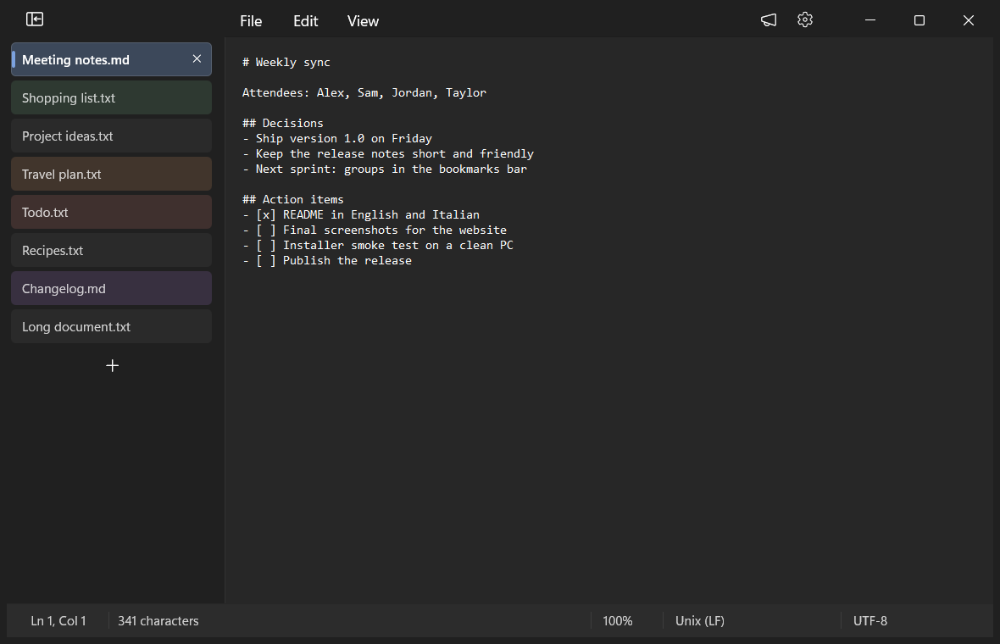
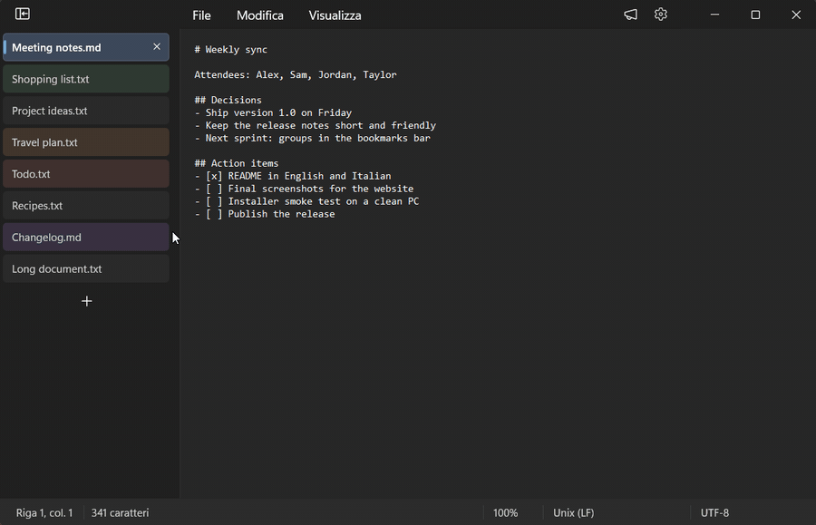
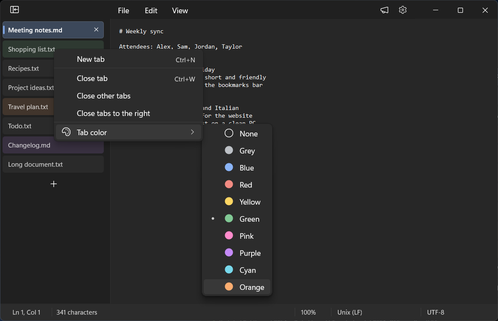
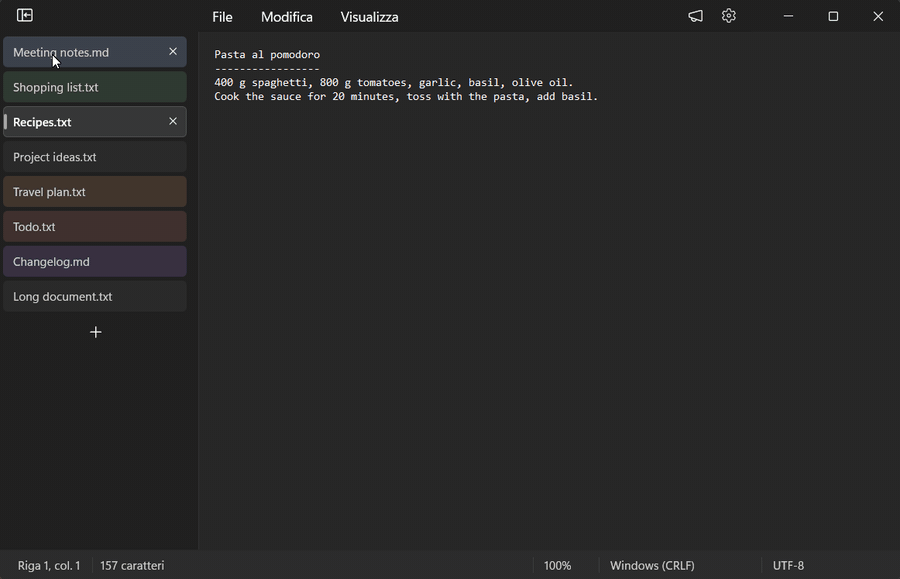
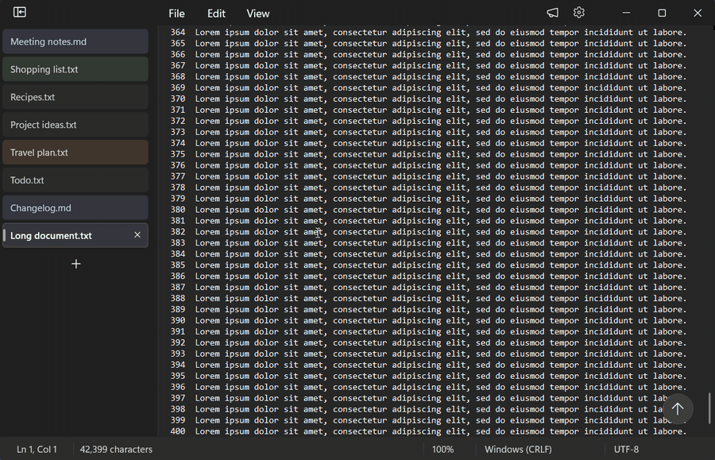
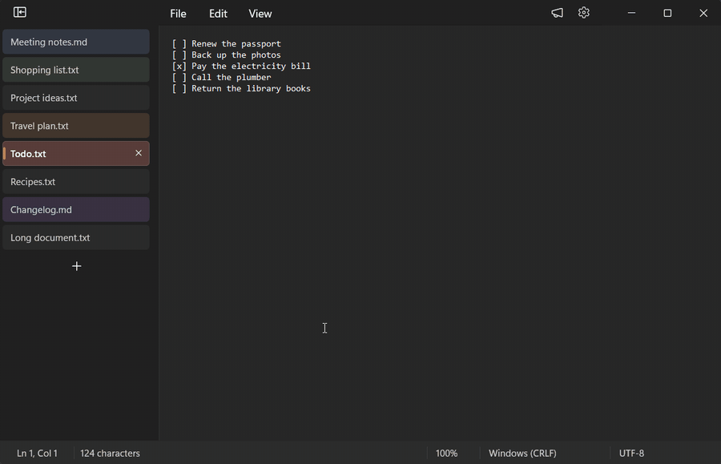
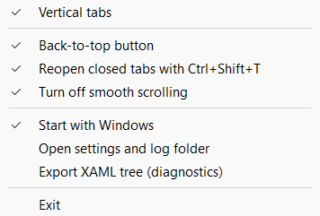

# Vertical Tabs for Notepad

**Schede verticali come in Chrome per il Blocco note di Windows 11**, con i colori delle schede, un pulsante
"Torna su" e <kbd>Ctrl</kbd>+<kbd>Maiusc</kbd>+<kbd>T</kbd> per riaprire le schede chiuse.

[English](README.md) · **Italiano** · [Sito](https://lucasorvillo.github.io/vertical-tabs-notepad/?lang=it) ·
[Download](https://github.com/LucaSorvillo/vertical-tabs-notepad/releases/latest)



VTabsNotepad è una piccola app nella tray per il Blocco note di Windows 11. Non modifica e non sostituisce il
Blocco note. Mentre l'app è aperta, carica nel Blocco note un modulo che sposta le schede in una colonna a
sinistra. Sotto restano le schede, i menu e i comandi del Blocco note, quindi salvataggio, chiusura e
ripristino della sessione funzionano come sempre.

> [!NOTE]
> L'app parla la lingua di Windows: italiano se la lingua di visualizzazione di Windows è l'italiano,
> altrimenti inglese. Lo stesso vale per l'installazione. Gli screenshot mostrano Windows in inglese.

## Funzioni

### Schede verticali



- **Una colonna dalla cima della finestra**, come le schede verticali di Chrome ed Edge. La riga del titolo,
  rimasta vuota, si nasconde: la barra dei menu sale accanto ai pulsanti della finestra, e i pulsanti sono
  alti quanto la riga dei menu.
- **Lo stesso aspetto delle schede del Blocco note**: carattere, dimensione e colori vengono dalle schede
  originali, con lo sfondo Mica della barra del titolo. Segue il tema chiaro e scuro.
- **Clic** per cambiare scheda (la tastiera torna al testo), **clic centrale** o **X** per chiudere, **+** per
  una scheda nuova.
- **Si riordinano trascinando.** Si spostano anche le schede vere del Blocco note, quindi l'ordine resta nella
  sua sessione. Vicino ai bordi l'elenco scorre da solo, e <kbd>Esc</kbd> annulla.
- **Clic destro**: il menu della scheda del Blocco note (nuova scheda, chiudi, chiudi le altre, chiudi quelle
  a destra), più **Colore scheda**.
- **Si comprime** in sole icone con il pulsante in alto. **Si allarga** trascinando la linea divisoria (doppio
  clic per tornare alla misura iniziale). Larghezza e stato valgono per tutte le finestre.

| Colori delle schede | Pannello compresso |
| --- | --- |
|  |  |

I **colori delle schede** sono quelli dei gruppi di schede di Chrome: grigio, blu, rosso, giallo, verde, rosa,
viola, azzurro e arancione. La riga prende una tinta leggera e la scheda attiva una barretta colorata. I colori
si salvano e tornano dopo il riavvio del Blocco note.

### Torna su



Quando un documento scorre verso il basso, in basso a destra nell'editor compare sfumando un pulsante tondo con
la freccia. Un clic riporta all'inizio e restituisce la tastiera al testo. Ogni scheda tiene la sua posizione.

### Riapri le schede chiuse (<kbd>Ctrl</kbd>+<kbd>Maiusc</kbd>+<kbd>T</kbd>)



Come nel browser: la scheda chiusa per sbaglio torna **al suo posto** e diventa quella attiva. Premendo di
nuovo si va a ritroso, fino alle ultime 25 schede. Come in Chrome, la cronologia resta anche chiudendo la
finestra o il Blocco note.

Vale per i file salvati. Di ogni scheda si ricordano solo il percorso e la posizione, mai il contenuto. Una
scheda mai salvata non si può riaprire: per quelle il Blocco note chiede già se salvare quando le si chiude.
La scorciatoia si prende solo mentre è attiva una finestra del Blocco note, quindi resta libera per gli altri
programmi (il browser, per esempio).

### Scorrimento

- **Niente scorrimento fluido** (attivo all'inizio, si può spegnere): la rotella del mouse sposta il testo
  subito, riga per riga, senza l'animazione del Blocco note.
- **Le barre di scorrimento si allargano appena ci passa sopra il mouse**, senza il solito breve ritardo.
- **Correzioni per due difetti delle barre di scorrimento del Blocco note**: una barra verticale che compare
  anche quando il testo ci sta, e intervalli di scorrimento che restano vecchi fino al primo scorrimento.

## Requisiti

- Windows 11 a 64 bit (x64).
- Il Blocco note con le schede, dal Microsoft Store (`Microsoft.WindowsNotepad`).
- Sviluppato e provato su Windows 11 26H2 (build 26300) con il Blocco note 11.2607. L'app si appoggia
  all'interfaccia interna del Blocco note: un suo aggiornamento potrebbe rompere qualche funzione. Vedi
  [Limiti](#limiti).

## Installazione

1. Scarica `VTabsNotepad-<versione>-setup.exe` dall'[ultima release](https://github.com/LucaSorvillo/vertical-tabs-notepad/releases/latest).
2. Avvialo. Non servono diritti di amministratore: si installa in `%LOCALAPPDATA%\Programs\VTabsNotepad`.
   Come l'app, l'installazione segue la lingua di Windows (italiano o inglese).
3. L'app parte nell'area di notifica (tray) e aggiunge le schede verticali al Blocco note, anche alle finestre
   già aperte.

> [!IMPORTANT]
> L'installer non ha una firma digitale, quindi Windows SmartScreen può mostrare "PC protetto da Windows".
> Fai clic su **Ulteriori informazioni** › **Esegui comunque**. L'app carica un modulo dentro il Blocco note:
> qualche antivirus potrebbe segnalarlo. Il codice sorgente è tutto qui, e puoi compilarlo da te.

## Uso

Tutto è nel menu della tray (clic destro sull'icona):



| Voce del menu | Predefinito |
| --- | --- |
| Schede verticali | attiva |
| Pulsante «Torna su» | attiva |
| Riapri la scheda chiusa con Ctrl+Maiusc+T | attiva |
| Disattiva lo scorrimento fluido | attiva |
| Avvia con Windows | come scelto nell'installazione |
| Apri cartella impostazioni e log | |
| Esporta albero XAML (diagnostica) | |
| Esci | |

Con Windows in un'altra lingua le voci sono in inglese, come nell'immagine. **Esporta albero XAML** salva la
struttura dell'interfaccia del Blocco note nella cartella dei log: utile per segnalare un problema dopo un
aggiornamento del Blocco note.

Spegnendo le schede verticali torna subito la normale barra delle schede del Blocco note.

## Privacy

- L'app funziona offline: niente rete, niente telemetria, nessun account.
- Non legge e non salva mai il contenuto dei documenti.
- Tutto resta in `%LOCALAPPDATA%\VTabsNotepad`:
  - `settings.ini`: le opzioni del menu della tray e la larghezza della colonna.
  - `tab-colors.ini`: i colori delle schede, legati all'identificativo interno della scheda.
  - `closed-tabs.txt`: percorso e posizione delle ultime 25 schede chiuse (solo file salvati).
  - `logs\`: un registro diagnostico, che può contenere nomi di file. Controllalo prima di allegarlo a una
    segnalazione.
  - `runtime\`: una copia del modulo caricato nel Blocco note, così l'app si può aggiornare anche con il
    Blocco note aperto.

## Come funziona

`VTabsNotepad.exe` resta nella tray, tiene d'occhio i processi del Blocco note e ci carica
`VTabsNotepadMod.dll` (`CreateRemoteThread` + `LoadLibraryW`). Dentro il Blocco note, il modulo si collega
all'interfaccia WinUI 3 con `InitializeXamlDiagnosticsEx`, l'API che usa il Live Visual Tree di Visual Studio.
Trova la `TabsBar` del Blocco note (i suoi metadati pubblici sono nel Blocco note stesso, in
`NotepadXamlUI.winmd`) e costruisce la colonna in una sua isola XAML. La colonna è legata ai dati delle schede
del Blocco note e usa i suoi comandi.

La barra delle schede originale resta viva ma nascosta, quindi chiudere una scheda passa sempre dalla domanda
"Salvare le modifiche?" del Blocco note. Il modulo sposta le finestre figlie del Blocco note per fare posto
alla colonna e nasconde la riga del titolo. Disegna anche i propri pulsanti della finestra e adatta le barre di
scorrimento e la zona "vetro" della finestra.

I dettagli sono in [ARCHITECTURE.md](ARCHITECTURE.md) (in inglese). Le note di sviluppo complete, in italiano,
sono in [DESIGN-NOTES.it.md](DESIGN-NOTES.it.md).

## Compilazione

Servono:

- Windows 11 x64 con il Blocco note del Microsoft Store installato. Il suo `NotepadXamlUI.winmd` e il runtime
  Windows App SDK che usa vengono letti per generare le proiezioni C++/WinRT; nessun file Microsoft viene
  copiato nel repository.
- Visual Studio 2022 o successivo con **Sviluppo di applicazioni desktop con C++**: MSVC x64, Windows SDK
  con C++/WinRT, CMake e Ninja (tutti compresi nel carico di lavoro).
- [Inno Setup 6](https://jrsoftware.org/isinfo.php), solo per l'installer.

```powershell
.\build.ps1                     # Release in build\bin
.\build.ps1 -Config Debug       # versione di debug
.\build.ps1 -Clean              # ricompila tutto, proiezioni comprese
& "$env:LOCALAPPDATA\Programs\Inno Setup 6\ISCC.exe" installer\VTabsNotepad.iss   # installer in dist\
```

La prima compilazione scarica i metadati del pacchetto NuGet `Microsoft.Web.WebView2` (solo il suo `.winmd`),
a cui fa riferimento `Microsoft.UI.Xaml.winmd`.

`tools\test\Run-Tests.ps1` esegue i test automatici. Usano finestre vere del Blocco note con UI Automation:
avviali su un PC dove si possono aprire e chiudere finestre del Blocco note.

## Disinstallazione

**Impostazioni** › **App** › **App installate** › **Vertical Tabs for Notepad** › **Disinstalla**. La
disinstallazione chiude l'app nella tray e chiede se eliminare anche impostazioni e dati salvati. Le finestre
del Blocco note già aperte tengono le schede verticali finché il Blocco note non viene chiuso.

## Limiti

- L'app dipende da come è costruita dentro l'interfaccia del Blocco note, che un aggiornamento può cambiare. Se
  qualcosa non va, spegni la funzione dal menu della tray e
  [apri una segnalazione](https://github.com/LucaSorvillo/vertical-tabs-notepad/issues) indicando la versione
  del Blocco note.
- Solo x64.

## Vedi anche

[Vertical Tabs for File Explorer](https://github.com/LucaSorvillo/vertical-tabs-explorer/blob/main/README.it.md):
le stesse schede verticali per Esplora file, con il ripristino delle finestre e una barra delle cartelle come
quella di Chrome.

## Licenza

[MIT](LICENSE). Questo progetto non è affiliato a Microsoft né approvato da Microsoft. Windows e Blocco note
sono marchi di Microsoft Corporation.
