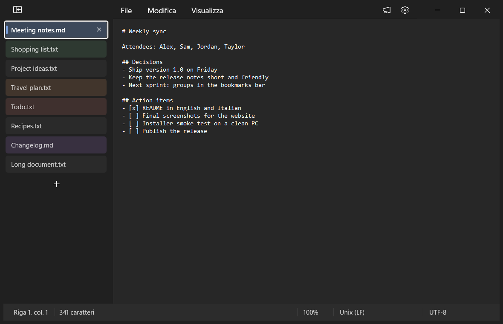
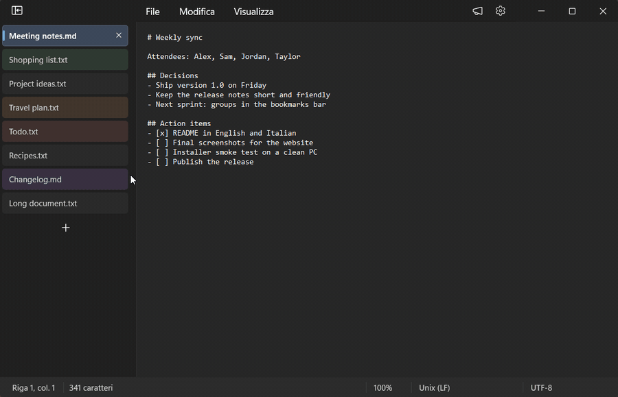
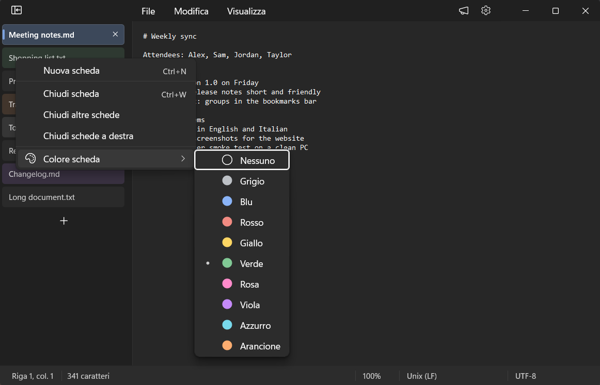
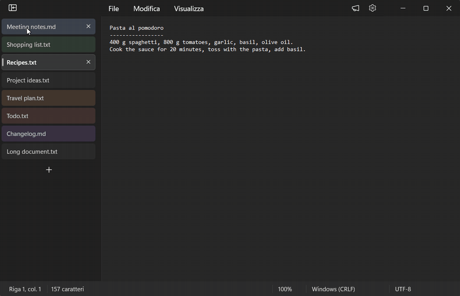
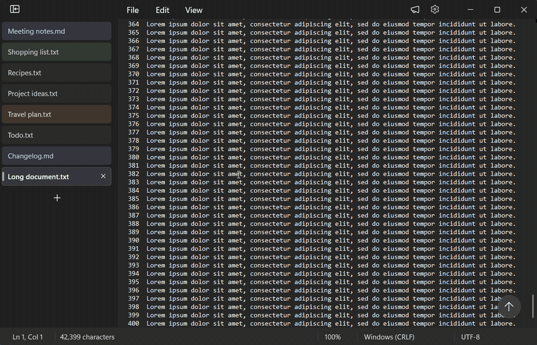
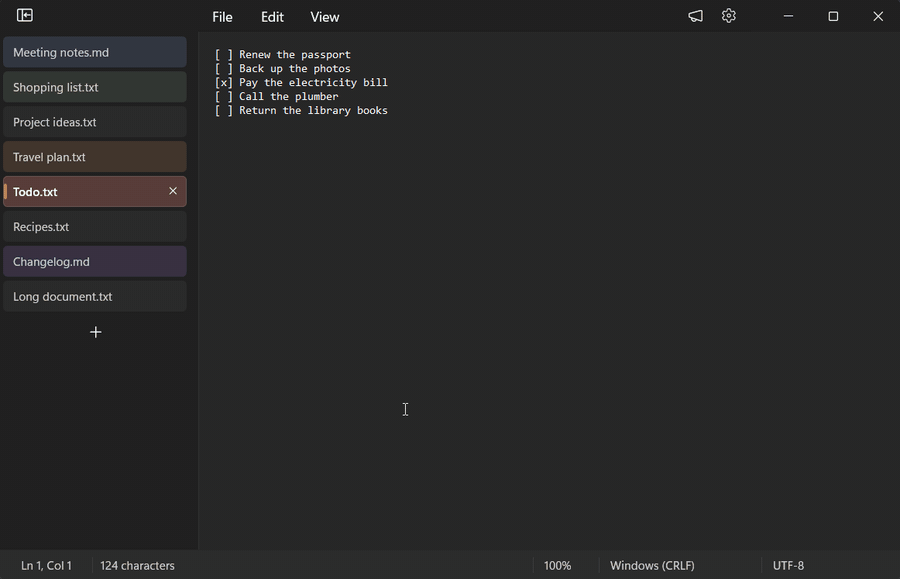
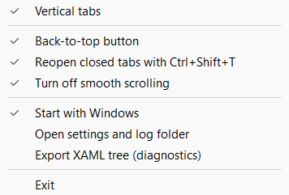

#  Vertical Tabs for Notepad

**Chrome-style vertical tabs for the Windows 11 Notepad**, plus tab colors, a "back to top" button and
<kbd>Ctrl</kbd>+<kbd>Shift</kbd>+<kbd>T</kbd> to reopen closed tabs.

**English** · [Italiano](README.it.md) · [Website](https://lucasorvillo.github.io/vertical-tabs-notepad/) ·
[Download](https://github.com/LucaSorvillo/vertical-tabs-notepad/releases/latest)



VTabsNotepad is a small tray app for the Notepad that comes with Windows 11. It doesn't patch or replace
Notepad. While the app runs, it loads a module into Notepad that moves the tabs into a column on the left.
Under the hood they are still Notepad's own tabs, menus and commands, so saving, closing and session restore
keep working as usual.

> [!NOTE]
> The app speaks the language of Windows: Italian if the Windows display language is Italian, English
> otherwise. The setup does the same.

## Features

### Vertical tabs



- **A column from the top of the window**, like the vertical tabs in Chrome and Edge. The empty title row
  is hidden: the menu bar moves up next to the window buttons, and the window buttons are as tall as the menu
  row.
- **Same look as Notepad's tabs**: font, size and colors come from the native tabs, with the Mica background
  of the title bar. Follows the light and dark theme.
- **Click** to switch (the keyboard goes back to the text), **middle-click** or **X** to close, **+** for a new
  tab.
- **Drag to reorder.** Notepad's real tabs move too, so the order is kept in Notepad's session. The list
  scrolls near its edges, and <kbd>Esc</kbd> cancels.
- **Right-click**: Notepad's own tab menu (new tab, close, close others, close to the right), plus
  **Tab color**.
- **Collapse** to icons with the button at the top. **Resize** by dragging the divider (double-click resets
  it). Width and state apply to all windows.

| Tab colors | Collapsed |
| --- | --- |
|  |  |

**Tab colors** are the colors of Chrome's tab groups: grey, blue, red, yellow, green, pink, purple, cyan
and orange. The whole row gets a light tint, and the active tab gets a colored bar. Colors are saved and come
back after Notepad restarts.

### Back to top



When you scroll down a document, a round button with an arrow fades in at the bottom right of the editor.
One click scrolls back to the top and returns the keyboard to the text. Each tab keeps its own position.

### Reopen closed tabs (<kbd>Ctrl</kbd>+<kbd>Shift</kbd>+<kbd>T</kbd>)



Like in a browser: the tab you closed by mistake comes back **in its place**, with its color, and
becomes the active tab.
Press again to go further back, up to the last 25 tabs. Like in Chrome, the history survives closing the
window or Notepad.

It works for saved files. Only the path and the position of each tab are stored, never the content. A tab
that was never saved can't be reopened: for those, Notepad already asks whether to save when you close them.
The shortcut is taken only while a Notepad window is active, so other apps (your browser, for example) keep
it.

### Scrolling details

- **No smooth scrolling** (on by default, can be turned off): the mouse wheel moves the text right away, line
  by line, without Notepad's animation.
- **Scrollbars expand as soon as you hover** them, without the usual short delay.
- **Fixes for two Notepad scrollbar glitches**: a vertical scrollbar that appears when the text fits, and
  scroll ranges that stay outdated until the first scroll.

## Requirements

- Windows 11, 64-bit (x64).
- The Notepad with tabs, from the Microsoft Store (`Microsoft.WindowsNotepad`).
- Developed and tested on Windows 11 26H2 (build 26300) with Notepad 11.2607. The app relies on Notepad's
  internal user interface, so a future Notepad update may break some features. See [Limitations](#limitations).

## Installation

1. Download `VTabsNotepad-<version>-setup.exe` from the
   [latest release](https://github.com/LucaSorvillo/vertical-tabs-notepad/releases/latest).
2. Run it. No administrator rights are needed: it installs into `%LOCALAPPDATA%\Programs\VTabsNotepad`.
   Like the app, the setup follows the Windows language (Italian or English).
3. The app starts in the notification area (tray) and adds the vertical tabs to Notepad, including windows
   that are already open.

> [!IMPORTANT]
> The installer isn't code-signed, so Windows SmartScreen may show "Windows protected your PC". Click
> **More info** › **Run anyway**. The app loads a module into Notepad: some security software may flag that
> behavior. The source code is all here, and you can build it yourself.

## Usage

Everything is in the tray menu (right-click the icon):



| Menu item | Default |
| --- | --- |
| Vertical tabs | on |
| Back-to-top button | on |
| Reopen closed tabs with Ctrl+Shift+T | on |
| Turn off smooth scrolling | on |
| Start with Windows | as chosen in the setup |
| Open settings and log folder | |
| Export XAML tree (diagnostics) | |
| Exit | |

**Export XAML tree** saves the structure of Notepad's interface to the log folder: useful when you report a
problem after a Notepad update.

Turning off the vertical tabs brings back Notepad's normal tab strip right away. **Exit** removes the app from
every open Notepad window: the module unloads and nothing of it stays inside Notepad. It all comes back when you
start the app again, also in the windows already open.

## Privacy

- The app works offline: no network access, no telemetry, no accounts.
- It never reads or stores the content of your documents.
- Everything stays in `%LOCALAPPDATA%\VTabsNotepad`:
  - `settings.ini`: the tray menu options and the column width.
  - `tab-colors.ini`: tab colors, by Notepad's internal tab id.
  - `closed-tabs.txt`: path, position and color of the last 25 closed tabs (saved files only).
  - `logs\`: a diagnostic log, which can contain file names. Have a look before sharing it in an issue.
  - `runtime\`: a copy of the module loaded into Notepad, so the app can be updated while Notepad is open.
  - `tray-exited.txt`: there only while the app is closed with **Exit**, so the module knows to leave the open
    Notepad windows.

## How it works

`VTabsNotepad.exe` stays in the tray, watches for Notepad processes and loads `VTabsNotepadMod.dll` into
them (`CreateRemoteThread` + `LoadLibraryW`). Inside Notepad, the module finds the WinUI 3 interface by hooking
a few public methods of the controls Notepad uses (its tab bar, menu bar and scrollbars), plus a UI Automation
search for the windows already open. It finds Notepad's `TabsBar` (its public metadata ships with Notepad, in
`NotepadXamlUI.winmd`) and builds the column in its own XAML island. On **Exit** it puts everything back and
unloads. The column is bound to Notepad's tab data and drives Notepad's own commands.

The original tab strip stays alive but hidden, so closing a tab still goes through Notepad's "Save changes?"
dialog. The module moves Notepad's child windows to make room for the column and hides the title row. It also
draws its own window buttons and adjusts the scrollbars, the glass area of the window and the width Notepad uses for
the tables of formatted Markdown.

The details are in [ARCHITECTURE.md](ARCHITECTURE.md). The full development notes (in Italian) are in
[DESIGN-NOTES.it.md](DESIGN-NOTES.it.md).

## Building from source

You need:

- Windows 11 x64 with the Store Notepad installed. Its `NotepadXamlUI.winmd` and the Windows App SDK runtime
  it uses are read to generate the C++/WinRT projections; no Microsoft file is copied into the repository.
- Visual Studio 2022 or later with **Desktop development with C++**: MSVC x64, Windows SDK with C++/WinRT,
  CMake and Ninja (all included in the workload).
- [Inno Setup 6](https://jrsoftware.org/isinfo.php), only for the installer.

```powershell
.\build.ps1                     # Release build in build\bin
.\build.ps1 -Config Debug       # debug build
.\build.ps1 -Clean              # rebuild everything, projections included
& "$env:LOCALAPPDATA\Programs\Inno Setup 6\ISCC.exe" installer\VTabsNotepad.iss   # installer in dist\
```

The first build downloads the metadata of the `Microsoft.Web.WebView2` NuGet package (only its `.winmd`),
which `Microsoft.UI.Xaml.winmd` refers to.

`tools\test\Run-Tests.ps1` runs the automated tests. They drive real Notepad windows with UI Automation, so
run them on a PC where Notepad windows can be opened and closed.

## Uninstall

**Settings** › **Apps** › **Installed apps** › **Vertical Tabs for Notepad** › **Uninstall**. The
uninstaller closes the tray app, so open Notepad windows go back to the normal tabs right away, and asks
whether to delete the settings and saved data too.

## Limitations

- The app depends on how Notepad's interface is built inside. An update of Notepad can change it. If something
  looks wrong, turn the feature off from the tray menu, and please
  [open an issue](https://github.com/LucaSorvillo/vertical-tabs-notepad/issues) with your Notepad version.
- x64 only.

## Related

[Vertical Tabs for File Explorer](https://github.com/LucaSorvillo/vertical-tabs-explorer): the same
vertical tabs for File Explorer, with session restore and a Chrome-like folders bar.

## License

[MIT](LICENSE). This project isn't affiliated with or endorsed by Microsoft. Windows and Notepad are
trademarks of Microsoft Corporation.
